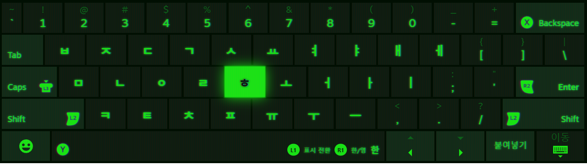

# Steam 한글 가상 키보드

<p align="center"></p>

<p align="center">Steam 가상 키보드에서 <b>한글을 보고 입력</b>할 수 있게 해줍니다.</p>

## 이게 뭔가요?

Steam에서 글자를 입력하면 **가상 키보드**가 뜹니다.
이 키보드는 영문 자판만 표시해서, 한글을 쓰려면 자모 위치를 외워야 했습니다.

이 프로그램을 켜면 키보드가 이렇게 바뀝니다.



<sub>실제 가상 키보드에 한글 자모가 표시된 모습 (사용 중인 스킨)</sub>

- 자판에 한글이 보입니다 (`ㅂㅈㄷㄱ…`), Shift를 누르면 `ㄲㄸㅃㅆ`
- **R1** = 한/영 전환
- **L1** = 표기만 바꿔서 화면과 실제를 맞춤
- 스페이스바 오른쪽에 현재 상태(`한`/`영`)가 표시됩니다

가상 키보드가 지원되는 곳에서 작동합니다.

Steam 프로그램 파일은 건드리지 않습니다. 켜져 있는 동안 화면만 바꿔 줍니다.

## 시작하기 전에

설치하면 Steam 폴더에 **표시 파일 하나**(`.cef-enable-remote-debugging`)를 추가합니다.
Steam은 이 파일이 있으면 켜질 때 **다른 프로그램이 접근할 수 있는 문**을 열어 둡니다.

덕분에 **평소처럼 Steam을 켜도** 이 프로그램이 바로 붙습니다.
(바탕화면의 `Steam (Korean)` 바로가기로 켜도 똑같이 동작합니다.)

> **중요:** Steam은 켤 때만 이 파일을 읽습니다.
> 설치할 때 Steam이 이미 켜져 있었다면 **한 번은 완전히 종료했다가 다시 실행**해야 합니다.
>
> 포터블은 첫 실행 때 관리자 권한을 한 번만 요청합니다.
> 이 파일은 Steam 프로그램 자체를 수정하지 않습니다. 지우면 원래대로 돌아갑니다.

## 설치

### 릴리스에서 설치 (권장)

1. [Releases](../../releases)에서 최신 `SteamKoreanKeyboard-*.zip` 다운로드
2. 압축을 풀고 `install.cmd` 실행 → UAC 창에서 **예**
3. **Steam이 이미 켜져 있었다면 트레이 메뉴에서 완전히 종료**한 뒤, 바탕화면의 **`Steam (Korean)`** 바로가기 실행
   - Steam과 앱이 함께 실행됩니다
   - 처음 한 번은 이 재시작이 꼭 필요합니다

설치 위치: `<Steam 폴더>\steam-osk-korean` (기본: `C:\Program Files (x86)\Steam\steam-osk-korean`)

설치 폴더에서 직접 실행할 때: **`SteamKoreanKeyboard.exe`** (트레이 아이콘)

### 포터블 (파일 하나)

1. `SteamKoreanKeyboard.exe` 실행
2. 처음 한 번 관리자 권한 요청 → **예**
3. Steam을 완전히 종료했다가 다시 실행
4. 트레이 아이콘에서 **자동** 모드인지 확인 (기본값: 자동)

## 사용법

### 트레이 메뉴

| 항목 | 설명 |
|---|---|
| **자동** | 창마다 한/영 상태를 따라갑니다 (메모장·탐색기 같은 앱은 읽지 못하는 경우도 있습니다) |
| **수동** | 상태를 따라가지 않고, 직접 바꿉니다 |
| **Off** | 잠시 끄고 원래 키보드로 돌아갑니다 |
| **Windows 시작 시 실행** | 컴퓨터를 켤 때 자동으로 실행 |
| **연결 상태 확인** | Steam 연결 상태와 해결 방법을 보여줍니다 |
| **로그 열기** | 로그 파일을 메모장으로 엽니다 |
| **종료** | 프로그램 종료 |

### 키

| 키 | 동작 |
|---|---|
| **R1** | 한/영 전환 |
| **L1** | 표시 전환 (표기만) |
| **L2** | Shift (쌍자음·쌍모음) |
| **CapsLock** | 한글: 쌍자음 잠금 · 영문: 대문자 |

### 스페이스바

스페이스바 오른쪽에 키 역할이 표시됩니다.

```
L1 표시 전환   R1 한/영   한
```

## 한/영 표기가 반대일 때

한/영 상태를 100% 자동으로 맞추는 것은 불가능합니다.

- 한/영 상태는 **각 프로그램**이 가지고 있어서 밖에서 정확히 읽을 수 없습니다
- 작업표시줄 입력 표시기나 `Win+Space`로 바꾸면 이 프로그램은 알 수 없습니다

그래서 **L1(표시 전환)** 이 있습니다.
표기가 실제와 반대일 때 L1을 한 번 누르면 **입력은 그대로 두고 표기만** 뒤집혀서 화면과 실제가 맞습니다.

| 키 | 바꾸는 것 |
|---|---|
| **R1** | 실제 한/영 상태 + 표기 |
| **L1** | 표기만 |

## 안 되나요?

### 가상 키보드에 한글이 안 보여요

1. **Steam을 완전히 종료했다가 다시 실행했나요?**
   Steam은 켤 때만 표시 파일을 읽습니다. 설치 후 한 번은 꼭 재시작해야 합니다.
2. 트레이 아이콘 → **연결 상태 확인**을 눌러 보세요.
   - `디버그 포트: 연결됨`이면 정상입니다.
   - `연결 안 됨`이면 아래를 확인하세요.
3. **일반 데스크톱 채팅창에서는 가상 키보드가 뜨지 않습니다.**
   Big Picture 모드나 게임패드로 글자를 입력할 때 확인하세요.
4. Steam 업데이트 후 표시 파일이 지워질 수 있습니다.
   앱을 다시 실행하면 관리자 권한을 요청하며 파일을 다시 만듭니다.

### "Steam 연결 대기 중" 알림이 떠요

Steam이 실행 중인데 디버그 포트가 닫힌 상태입니다.

1. Steam 트레이 메뉴 → **종료**
2. 바탕화면의 **Steam (Korean)** 바로가기 실행

### 8080 포트를 다른 프로그램이 쓰고 있어요

괜찮습니다. 이 앱은 8080에서 응답이 와도 그것이 **Steam의 CDP인지 확인**한 뒤
아니면 다른 주소(IPv4 ↔ IPv6)로 넘어갑니다.

- 정상: 로그에 `cdp http://127.0.0.1:8080/json/list` 또는 `cdp http://[::1]:8080/json/list`
- 둘 다 다른 프로그램이 쓰고 있으면 Steam 디버그 포트를 쓸 수 없으므로,
  해당 프로그램의 포트를 바꾸는 것이 가장 확실합니다.

### 로그 확인

트레이 아이콘 → **로그 열기**를 누르거나, 아래 파일을 열어 보세요.

```
C:\Program Files (x86)\Steam\steam-osk-korean\SteamKoreanKeyboard.log
```

## 삭제

`Steam\steam-osk-korean\uninstall.cmd` 실행.

- 설치 폴더, 바탕화면 바로가기, 시작 프로그램 등록을 지웁니다
- Steam 폴더의 `.cef-enable-remote-debugging` 표시 파일도 지웁니다
- **Steam 프로그램 자체는 건드리지 않습니다**

## 만든 방식

<details>
<summary>펼치기</summary>

### 동작 원리

```
Steam 가상 키보드 (웹 페이지)
  ├─ CSS/JS 주입: 자모 표시, L1/R1, 스페이스 표시
  └─ 글자 입력 → 로컬 서버(8793) → 키 이벤트 전송
        ▲
SteamKoreanKeyboard.exe (C#)
  ├─ Steam의 디버그 포트(8080)로 접속
  ├─ 키 입력 가로채기 (ControllerKeyboardSendText)
  └─ 한/영 상태 추적 + 전환
```

- Steam 파일 수정 없음, 후킹·드라이버·서비스 없음
- 네트워크 통신 없음 (127.0.0.1 로컬만)
- 로컬 API: `/state`, `/hangul`, `/flip`, `/key` (실행할 때마다 새로 만드는 토큰 필요)
- Steam 폴더의 `.cef-enable-remote-debugging` 표시 파일이 디버그 포트(8080)를 엽니다
- 디버그 포트는 IPv4(`127.0.0.1`)를 먼저 시도하고, 안 되면 IPv6(`[::1]`)도 시도합니다
- 8080 포트를 다른 프로그램이 쓰고 있어도, 응답이 CDP 형식인지 확인한 뒤 넘어갑니다

> **보안 참고**
> 이 표시 파일은 Steam의 디버그 포트를 **127.0.0.1(내 PC)** 에만 엽니다. 외부 네트워크에서는 접근할 수 없습니다.
> 같은 PC의 다른 프로그램은 Steam 화면에 접근할 수 있게 되므로, 신뢰할 수 없는 프로그램을 쓰는 PC라면 파일을 지우고 Steam을 재시작하세요.
> 앱의 로컬 API는 실행 시 발급되는 랜덤 토큰으로 보호됩니다.

### 기술 요구 사항

- Windows 10 / 11 (.NET Framework 4.8 내장)
- Steam 디버그 포트(8080)가 열려 있어야 함
- 첫 설치 후 Steam을 한 번 완전히 재시작해야 함
- Windows 한국어 IME (2벌식)

### 빌드

```bat
build.cmd     :: exe 빌드
release.cmd   :: 릴리스 zip 생성
```

- .NET Framework 4.x의 `csc.exe`만 사용합니다 (외부 패키지 없음)
- 아이콘 재생성: `python tools/make-icon.py`
- README 미리보기: `preview.cmd` (브라우저로 열림)

### 파일 구성

| 파일 | 설명 |
|---|---|
| `SteamKoreanKeyboard.exe` | 엔진 + 트레이 UI (payload 내장) |
| `payload.js` | 가상 키보드 주입 스크립트 (exe에 내장, 같은 폴더에 있으면 우선 사용) |
| `start.cmd` | Steam을 디버그 포트로 실행 + 앱 시작 (설치형 바로가기용) |
| `install.cmd` / `uninstall.cmd` | 설치 / 삭제 |
| `app.ico` | 아이콘 (빌드 시 exe에 포함) |
| `docs/icon.png` | README용 아이콘 |
| `tools/make-icon.py` | 아이콘 재생성 스크립트 |
| `Diagnostics.cs` | 트레이 "연결 상태 확인" 메시지 |
| `release.ps1` | 릴리스 zip 생성 |
| `.github/workflows/build.yml` | GitHub Actions 빌드 |

</details>

## 라이선스

MIT License — [LICENSE](LICENSE)

이 프로젝트는 Valve Corporation과 무관하며, Valve의 공식 소프트웨어가 아닙니다.
Steam 및 관련 상표는 Valve Corporation의 자산입니다.
